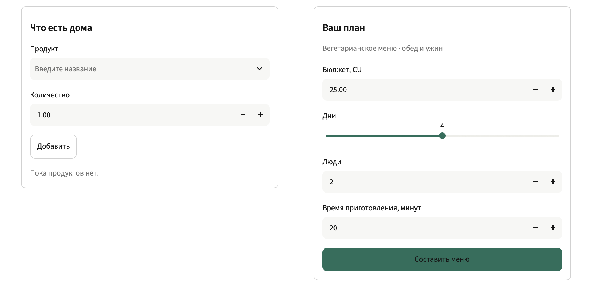
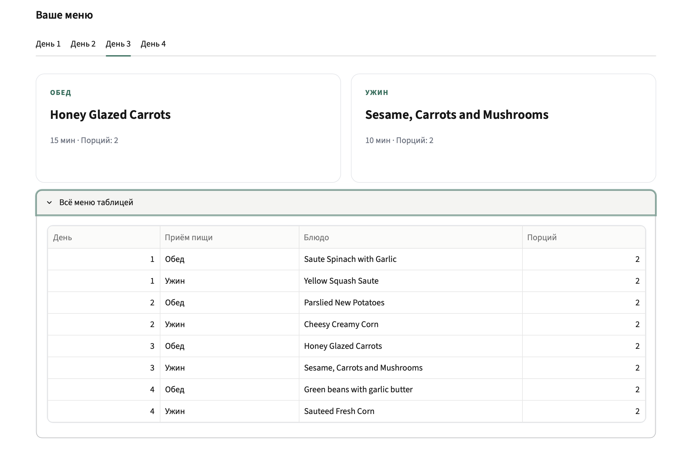
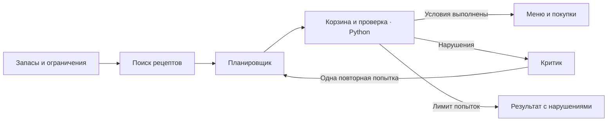

<p align="center">
  
</p>

<p align="center">
  <a href="#быстрый-запуск"><strong>Запустить</strong></a> ·
  <a href="#как-это-работает"><strong>Архитектура</strong></a> ·
  <a href="docs/README.md"><strong>Документация</strong></a> ·
  <a href="docs/ARCHITECTURE.md"><strong>Архитектура</strong></a>
</p>

<p align="center">
  
  
  
  <a href="LICENSE"></a>
</p>

**Smart Grocery Agents** составляет меню и список покупок по домашним запасам,
бюджету, ограничениям питания и времени приготовления. Планировщик выбирает блюда
и предлагает исправления, Python рассчитывает корзину и проверяет условия.

> **Учебный MVP.** Приложение запускается локально. Исходное меню использует демонстрационные цены CU; интеграционный сценарий — тестовые цены RUB. Реальные предложения магазинов показываются отдельно с ограничениями по наличию и составу. Общедоступная версия на сервере пока не опубликована.

**[Единая версия: запуск, результаты проверок и ограничения](docs/UNIFIED_VERSION.md)** · объединены каталог, персонализация, запасы и магазины.

**Новый спринт — магазины.** Экран «Товары магазинов» показывает реальные
предложения публичного каталога ВкусВилла и считает целые упаковки.
Адресное наличие и аллергены остаются неподтвержденными.
[Результаты проверки, запуск и ограничения](docs/RETAIL.md).
### Каталог нового спринта

[Полный локальный каталог](docs/CATALOG.md) содержит **522 798 рецептов** Food.com и Wikibooks: поиск по названию/ингредиентам, инструкции, источники и отчет качества. Полная база строится командой `python scripts/build_catalog_db.py --download`; в Git включена автономная версия на **8681 рецепт**. Неполные данные не подменяют исходный планировщик.

## Возможности

| Вы задаете | Получаете |
|---|---|
| Продукты, которые уже есть дома | Покупки с учетом запасов |
| Число дней и людей | Обеды и ужины с расчетом порций |
| Бюджет, диету и время | Подбор допустимых рецептов и проверку меню |
| Измененные ограничения | Повторный расчет и историю попыток |

**Запасы и параметры**



**Меню по дням**



## Быстрый запуск

Нужны Git и запущенный Docker Desktop. Подготовленные данные включены
в репозиторий; для первого запуска API-ключ не требуется.

```bash
git clone https://github.com/asastyy/smart-grocery-agents.git
cd smart-grocery-agents
cp .env.example .env
docker compose up --build
```

Откройте **[localhost:8501](http://localhost:8501)**. По умолчанию включен
демонстрационный режим (`MOCK_LLM=true`). Остановка: `docker compose down`.

<details>
<summary><strong>Запуск без Docker · Python 3.11+</strong></summary>

Из корня скачанного репозитория:

```bash
python -m venv .venv
source .venv/bin/activate
python -m pip install -r requirements.txt
cp .env.example .env
python -m streamlit run app.py
```

В Windows PowerShell активация: `.\.venv\Scripts\Activate.ps1`.
Для копирования настроек используйте `Copy-Item .env.example .env`.
Та же команда копирования подходит для Docker в Windows.

</details>

### Подключить LLM-провайдера

Создайте локальный `.env` по шаблону `.env.example` и укажите параметры
совместимого Chat Completions API.

```dotenv
MOCK_LLM=false
LLM_API_KEY=YOUR_LOCAL_API_KEY
LLM_BASE_URL=https://provider.example/v1
LLM_MODEL=provider-model-name
CRITIC_MODEL=
```

Пустой `CRITIC_MODEL` означает ту же модель, что у планировщика. После изменения
`.env` перезапустите Streamlit или контейнер (`docker compose up --force-recreate`).
Экспортированные переменные окружения имеют приоритет над `.env`.

Ключ хранится только локально. `.env` исключен из Git, `.env.example` содержит
шаблон. [Настройка и проверка критика →](docs/CRITIC.md)

## Как это работает



1. **Поиск** отбирает рецепты по диете и времени.
2. **Планировщик** выбирает ID из кандидатов. Ответ проверяется по схеме.
3. **Python** рассчитывает порции, вычитает запасы, проверяет стоимость,
   единицы, бюджет и заполненность меню.
4. **Критик** получает нарушения и рекомендует изменить выбор. Цикл ограничен
   двумя попытками; обе видны в истории.

### Зачем здесь LLM

Фильтры находят допустимые рецепты. LLM составляет меню из кандидатов
и пересматривает его по текстовым замечаниям. Планировщик и критик выполняют
разные роли; расчеты и итог проверки принадлежат Python.

Для короткого цикла достаточно обычного Python.
[Модули, границы ответственности и обработка сбоев →](docs/ARCHITECTURE.md)

## Данные и границы MVP

| Рецепты Food.com | Нормализованные ингредиенты | Демонстрационные цены |
|:---:|:---:|:---:|
| **150** | **503** | **503** |

- Цены в CU синтетические и не отражают цены магазинов.
- Часть количеств задана в штуках (`pcs`). Пошаговых инструкций приготовления
  в исходном наборе нет.
- Неизвестные цены и несовместимые единицы дают отдельное нарушение.
  Неполная стоимость отображается явно.
- В демонстрационном режиме API не вызывается. Для сетевой проверки настройте
  совместимый LLM-провайдер.

[Источник, подготовка и пересборка данных →](docs/DATA_NOTES.md)

## Структура проекта

```text
smart-grocery-agents/
├── app.py                 # интерфейс Streamlit
├── src/smart_grocery/
│   ├── agents/            # планировщик, проверка, критик
│   ├── tools/             # поиск и расчет корзины
│   ├── schemas/           # модели данных
│   └── workflow/          # цикл планирования и проверки
├── data/                  # подготовленные рецепты, ингредиенты и цены
├── fixtures/              # запросы и ответы для проверок
├── tests/                 # модульные и интеграционные тесты
├── scripts/               # подготовка данных и запуск сценариев
├── examples/              # небольшие примеры данных
├── docs/                  # документация и материалы защиты
├── Dockerfile
├── compose.yaml
└── .env.example
```

## Проверки

После установки Python-зависимостей из корня проекта:

```bash
python -m pytest -q
python scripts/check_data.py
MOCK_LLM=true python scripts/run_foodcom.py
```

Последняя проверка общей сборки: **240 тестов локально и в контейнере**, запуск Docker, реальный цикл Gemini и контроль границ данных. [Протокол общей версии →](docs/UNIFIED_VERSION.md)

Шаблон автоматических проверок: [`docs/github-tests.yml`](docs/github-tests.yml).
GitHub Actions пока не включен: для публикации workflow нужно соответствующее
право GitHub-токена.

## Документация 

| Материал | Содержание |
|---|---|
| [Навигатор документации](docs/README.md) | Все инструкции по разделам |
| [Архитектура](docs/ARCHITECTURE.md) | Процесс и принятые решения |
| [Контракты](docs/CONTRACTS.md) | Форматы данных между модулями |
| [Технический обзор](docs/PROJECT_PROPOSAL.md) | Архитектура, демонстрационный поток и ограничения |
| [Проверка требований](docs/COURSE_REQUIREMENTS_AUDIT.md) | Соответствие реализации критериям проекта |
| [Протокол проверки](docs/ROLE_4_VALIDATION.md) | Тесты, контейнеры и сетевой режим |

