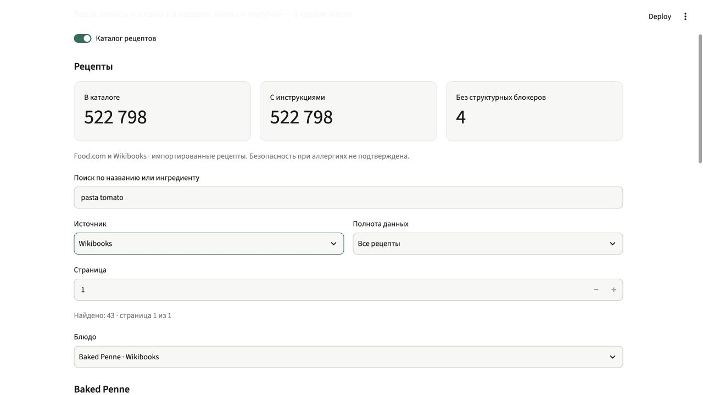

# Масштабируемый каталог рецептов — роль 1

Обновление 26 ноября 2026 года. Реализация Анастасии Сергеевой, отдельная ветка `codex/recipe-catalog`, PR #8 поверх контрактов PR #6. Существующий планировщик, исходные 150 рецептов и цены CU сохранены. Полный новый каталог предназначен для поиска, просмотра инструкций и подготовки данных; автоматическая закупка всех импортированных рецептов не подтверждена.

## Фактический объем

| Источник / результат | Количество |
|---|---:|
| Все исходные строки Food.com v2 | 522 517 |
| Food.com после парсера и дедупликации | 519 096 |
| Страницы всего английского Cookbook, без перенаправлений | 5 192 |
| Wikibooks с разобранными ингредиентами и инструкциями | 3 702 |
| **Полный локальный поисковый каталог** | **522 798** |
| Автономная версия из Git, без скачивания полного Food.com | 8 681 |

Из Food.com не приняты 2847 строк, которые не прошли текущий парсер, и 574 точных дубля содержимого. При полном обходе Cookbook отклонены 1490 страниц: преимущественно справочные материалы без разобранных ингредиентов/инструкций. Отказ парсера не доказывает ошибку исходного рецепта. Новые страницы за пределами прежней категории дали 28 дополнительных рецептов.

[Полный отчет](../data/catalog/full_catalog_report.json), [проверка индекса и поиска](../data/catalog/full_catalog_validation.json), [отчет Wikibooks](../data/catalog/quality_report.json), [автономная выборка](../data/catalog/foodcom/sample-report.json).

## Запуск полного каталога

```bash
python -m pip install -r requirements.txt
# Первый запуск: полный публичный CSV Food.com v2 и локальный индекс
python scripts/build_catalog_db.py --download
python -m streamlit run app.py
```

Включить **Каталог рецептов**. Есть поиск по названию/ингредиентам, источники, фильтры полноты и страницы по 50 результатов. Загружается JSON только выбранного блюда. Исходные инструкции, количества, авторство и диагностические поля доступны в карточке.

Полная SQLite-база находится в `outputs/catalog.sqlite` (около 2,4 ГиБ), CSV и архив — в `data/raw/foodcom/`. Эти файлы исключены из Git. Проверенное публичное скачивание работает без ключа и входа в Kaggle. Сохраненная версия и SHA-256 CSV указаны в отчетах. Для повторной индексации уже скачанного CSV достаточно `python scripts/build_catalog_db.py`.

**В Git включена автономная выборка**, а не скрытый гигабайтный файл: первые 5000 исходных строк Food.com и полный снимок Wikibooks. Если локального индекса нет, интерфейс строит версию на 8681 уникальный рецепт без сети. Получение полного каталога выполняется явно командой `--download`. Размеры и количество на экране относятся к реально открытому локальному индексу.

```bash
# Явно построить автономный индекс отдельно от полного
python scripts/build_catalog_db.py --raw data/catalog/foodcom/sample-rows.jsonl.gz --database outputs/catalog-seed.sqlite
# Расширить Wikibooks на все страницы Cookbook, сохранив ранее закрепленные редакции
python scripts/import_recipes.py --all-pages
# После обновления источников перестроить общий индекс
python scripts/build_catalog_db.py
```

## Полнота: размер не равен готовности меню

| Поле | Food.com | Wikibooks |
|---|---:|---:|
| Инструкции | 519 096 | 3 702 |
| Время из источника | 516 979 | 547 |
| Порции | 337 302 | 532 |
| Кухня | 38 817 | 649 |
| Прием пищи | 7 565 | 126 |
| Исходные сведения о питании | 519 096 | 84 |
| Полностью нормализованные количества | 0 | 155 |
| Без текущих структурных блокеров | 0 | 4 |
| Подтвержденная аллергенная безопасность | 0 | 0 |

У Food.com **многие количества не содержат исходную единицу**. Число 1 у молока не означает 1 литр или 1 штуку. В 404410 принятых записях длины массивов ингредиентов и количеств различаются: количества не сопоставляются по сдвинутому zip и не дополняются выдуманными значениями. Значения NA сохраняют позиции в R-векторе. Все исходные ингредиенты остаются доступны для просмотра и последующего исправления.

`nutrition_source` сохраняет исходные числовые поля. Они не объявляются сопоставимыми КБЖУ на 100 г без подтвержденной базы расчета. `allergens_status="unknown"`, `allergens=null`; отрицательные теги источника не становятся доказательством безопасности. `high_protein` не выводится по наличию одного продукта.

Четыре структурно экспортируемых рецепта — не четыре проверенных безопасных блюда. В наборе есть десерт и кляр; отбор для слотов относится к персонализации. Разнообразное меню на 5 дней на новых реальных данных еще не подтверждено. `review_50.jsonl` остается очередью ручной проверки, а не фиктивным набором подтверждений.

## Нормализация и источник истины

Общий runtime-контракт остается `schemas.foodcom.Recipe`. Функция `planning_recipes()` передает только структурно полные записи Wikibooks. Частичные данные полного каталога не передаются автоматически в старый планировщик.

В Wikibooks масса/объем пересчитываются только внутри своей размерности. Cup и teaspoon нормализуются по определению, на которое явно ссылается сам рецепт; основание сохраняется. Непривязанные меры, регионально неоднозначные tablespoon, диапазоны, «по вкусу», неизвестные банки и плотности остаются неизвестными. Приготовленный рис не объединяется с сухим, целая курица — с грудкой. Связанные определения: [Cup](https://en.wikibooks.org/wiki/Cookbook:Cup), [Teaspoon](https://en.wikibooks.org/wiki/Cookbook:Teaspoon), [Tablespoon](https://en.wikibooks.org/wiki/Cookbook:Tablespoon).

Время Food.com берется из `TotalTime`, включая подготовку, а не только из `CookTime`. Для Wikibooks сохраняется однозначное значение сводки; отдельное длительное ожидание помечается эвристикой и требует проверки. Пропуски времени и порций не заменяются нулями или двумя порциями.

Аудит прежнего MVP показал рис, молоко, помидоры и масло в pcs; старый скрипт также допускал плотность 1 и fallback в штуки. Исторические данные не пересчитаны без доказательств. [Исходный аудит](../data/catalog/baseline_audit.json).

## Архитектура и воспроизводимость

- `foodcom.py`: публичное скачивание закрепленной версии, потоковый CSV, безопасный разбор R-векторов без eval, сохранение неизвестных полей.
- `wikibooks.py`: категория или весь Cookbook, загрузка по 50 страниц, повторное использование прежних редакций, wiki-парсер и отчет.
- `database.py`: потоковая загрузка, дедупликация ID/содержимого, SQLite FTS5, атомарная публикация новой базы после commit и quick_check. Ошибка пересборки сохраняет прежний индекс.
- `ui.py`: страничный поиск, ограничение числа результатов и чтение одной карточки. Поисковые rowid отбираются в FTS до чтения больших JSON. Небольшой кеш сбрасывается при смене файла базы; соединения только для чтения и закрываются после запроса.
- Исходный снимок Wikibooks закреплен редакциями, включен в Git и воспроизводится побайтово. Для большого Food.com включены воспроизводимый загрузчик, фиксированная версия и SHA-256; для автономной разработки — 5000 исходных строк без Images.

Полная SQLite локальная, в репозиторий не добавляется. Для каждого рецепта сохраняются исходный ID, источник, редакция/версия, автор при наличии и контрольная сумма. Исходная wiki-разметка и NA не подменяются результатами LLM. Дедупликация точная; семантически похожие варианты с разными текстами не объединяются.

## Проверки

```bash
python -m pytest -q
python scripts/check_catalog.py --rebuild
python scripts/check_full_catalog.py --raw data/raw/foodcom/recipes.csv
python scripts/check_data.py
python scripts/run_integration.py
```

173 теста прошли. Проверены NA-позиции, несовпадающие массивы, неизвестные единицы, длительности ISO, дубли, пагинация, безопасные параметры поиска, неизменность базы при ошибке, режим чтения и закрытие соединений. 100 строк полного CSV повторно разобраны и сопоставлены с базой; это проверка воспроизведения, не независимая оценка точности ингредиентов.

Фактические запросы на полной базе: `chicken rice` — 9161 совпадение, `pasta tomato` — 7316, `vegan` — 3584; первая страница из 50 результатов примерно 0,02–0,2 с в проверенном окружении. Это отдельные измерения, не гарантия скорости на другом компьютере. Проверка сохранена в full_catalog_validation.json.

В браузере подтверждены счетчик 522798, поиск pasta tomato (7316 результатов), вторая страница и фильтр Wikibooks (43 результата со сбросом на страницу 1).



Исходный Golden Test Case по-прежнему формирует 10 блюд и 1710 руб. Новый каталог при строгой аллергии на арахис ожидаемо дает no_candidates до LLM, поскольку состав не подтвержден. Импорт и поиск не требуют Gemini или магазинных сессий. Настоящие LLM-вызовы и Docker этой доработкой отдельно не проверялись.

## Лицензии и дальнейшие шаги

Тексты Wikibooks — CC BY-SA 4.0 с атрибуцией и ссылками на редакции/авторов: [лицензия](../data/catalog/LICENSE.md), [политика источника](https://en.wikibooks.org/wiki/Wikibooks:Copyrights). Food.com v2 имеет объявленную загрузчиком Kaggle CC0; происхождение и границы этой отметки описаны [отдельно](../data/catalog/foodcom/LICENSE.md). Код остается MIT. Изображения не скачивались.

TheMealDB исследован как дополнительный источник карточек; полная база с платными возможностями не выкачивалась в обход ограничений. [Условия](https://www.themealdb.com/terms_of_use.php), [API](https://www.themealdb.com/api.php), [исследование](../data/catalog/source_research.json).

Следующий приоритет — качество выбранных основных блюд: сверить 50 записей с первоисточниками, подтвердить единицы, порции, время и аллергены, оформить версионируемые аннотации. Затем согласовать ID с запасами и магазинными товарами и проверить новое меню на пять дней. Рост числа записей сам по себе эти блокеры не снимает.
