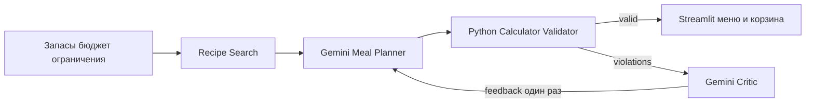

# Project Proposal Smart Grocery Agents

Этот план рассчитан на 10 минут презентации и 8 минут вопросов. Его цель —
показать понятную проблему, необходимость LLM и работающий live MVP. Перед
выступлением нужно заменить два незаполненных ФИО и перенести разделы ниже в
слайды команды.

## Структура выступления

| Время | Слайд | Спикер | Основная мысль |
|---|---|---|---|
| 0:00–1:00 | Проблема и пользователь | Анастасия | Из запасов, бюджета и ограничений трудно вручную составить связное меню и корзину. |
| 1:00–2:10 | Данные и поиск | Максим | 150 Food.com-рецептов, 503 нормализованных ингредиента, фильтрация по диете и времени. |
| 2:10–3:20 | Meal Planner | Рита | Gemini выбирает только ID кандидатов, возвращает структурированный JSON и получает feedback. |
| 3:20–4:30 | Calculator Validator Critic | Александра | Python считает и проверяет; отдельный Gemini-критик объясняет нарушения, но не меняет факты. |
| 4:30–5:30 | Архитектура и решения | Анастасия | Ограниченный цикл из двух попыток, Pydantic на границах, Python как источник истины. |
| 5:30–8:30 | Live demo | Все по своей части | Обычный запрос, затем бюджет 0 CU, критик, feedback и повторная проверка. |
| 8:30–9:20 | Качество и воспроизводимость | Анастасия | 91 тест, Docker healthy, безопасный `.env`, обработка ошибок и неизвестных цен. |
| 9:20–10:00 | Ограничения и следующий этап | Любой участник | Демо-цены и единицы; к final defense — сервер, улучшение данных и оценка качества меню. |

Каждый участник обязан присутствовать и представить минимум один слайд. Это
прямое требование курса, поэтому перед началом нужно вслух закрепить спикеров.

## Архитектура для слайда

Почему несколько ролей: Planner отвечает за выбор меню, Critic — за объяснение
конкретных нарушений. Разделение упрощает промпты и позволяет показать feedback
между агентами. Python остаётся источником истины для стоимости и валидности.

Почему нет LangGraph: текущий граф содержит один условный переход и максимум
две попытки. Обычный Python workflow короче, легче тестируется и не добавляет
зависимость без практической пользы. При появлении долгих процессов, сохранения
состояния между сессиями или нескольких ветвей LangGraph станет обоснованным.

## Live demo

До выступления:

1. Запустить Docker Desktop и проверить интернет.
2. Убедиться, что локальный `.env` содержит новый действующий ключ и
   `MOCK_LLM=false`; ключ не показывать на экране.
3. Выполнить `docker compose up --build` или запустить проверенный локальный UI.
4. Открыть http://localhost:8501 и убедиться, что сверху указан live-режим и
   `gemini-3.5-flash-lite`.
5. Закрыть вкладки с AI Studio, `.env` и настройками GitHub.

Во время demo:

1. Оставить пустые запасы, бюджет 25 CU, 3 дня, 2 человека, 30 минут.
2. Нажать «Составить меню» и показать 6 блюд, корзину, стоимость и успешную
   Python-проверку.
3. Поставить бюджет 0 CU и повторить запрос.
4. Показать `over_budget`, ответ `Critic [LLM, issue ...]` и вторую попытку.
5. Объяснить, что невалидный итог при нулевом бюджете и пустых запасах — честный
   результат, а не сбой модели.

Если API временно недоступен, показать mock-режим и протокол подтверждённой live
проверки в `docs/ROLE_4_VALIDATION.md`. Для двух баллов за core LLM feature лучше
восстановить live-вызов во время вопросов, поскольку mock сам по себе не
демонстрирует работу модели.

## Ответы на вероятные технические вопросы

**Зачем LLM, если есть фильтры?** Фильтры находят допустимые рецепты. LLM
составляет связное меню из кандидатов и пересматривает выбор по текстовому
feedback. Арифметика остаётся детерминированной.

**Как ограничены галлюцинации?** В prompt передаются допустимые ID, ответ
проверяется Pydantic, неизвестные ID отклоняются. Есть один повтор при
некорректном JSON и безопасный candidate-only fallback.

**Почему критик отдельный?** Он получает уже вычисленные нарушения и объясняет,
как их исправить. Он не может изменить стоимость, корзину или `valid`.

**Что происходит при сбое API?** Есть ограниченные retry, таймаут, валидация
ответа и безопасное сообщение без содержимого ответа провайдера и ключа.

**Как считается корзина?** Python масштабирует ингредиенты на число людей,
суммирует их, вычитает pantry и умножает остаток на цену. Decimal и явные
единицы защищают от неявного округления и конвертации.

**Что с неизвестной ценой?** `total_cost` становится `null`, отдельно выводится
`priced_subtotal`, а план получает нарушения `missing_price` и
`incomplete_cost`.

**Почему Gemini 3.5 Flash Lite?** Это стабильная быстрая модель с
структурированным выводом и бесплатным тарифом, достаточная для выбора ID и
коротких рекомендаций. Провайдер можно заменить через OpenAI-compatible
конфигурацию без изменения бизнес-логики.

**Какие ограничения данных?** Цены синтетические, часть исходных количеств имеет
единицу `pcs`, инструкции приготовления отсутствуют. MVP честно показывает эти
ограничения и не называет оценку реальной магазинной ценой.

## Контроль перед подключением к защите

- Команда зарегистрирована в Google-таблице курса.
- Все четыре участника присутствуют и знают свой слайд.
- В README указаны полные ФИО и GitHub-ники всех участников.
- GitHub-репозиторий открыт без авторизации.
- Live Gemini и запасной mock-сценарий запускаются.
- Docker Desktop уже запущен, образ собран до начала презентации.
- На экране нет API-ключа, `.env`, AI Studio и личных вкладок.
- Открыты Streamlit, GitHub README и архитектурный слайд.
- Таймер demo укладывается в три минуты, вся презентация — в десять.
