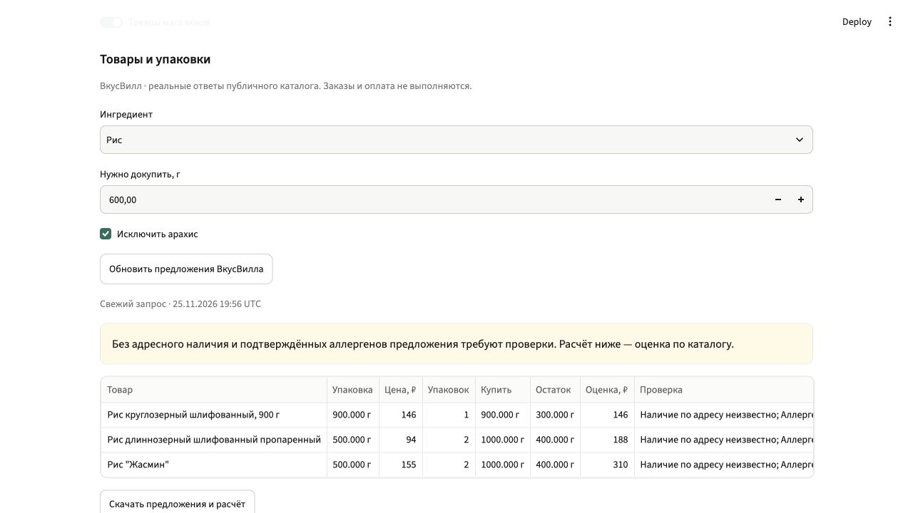

# Магазины и сопоставление товаров

Роль 3 трёхдневного спринта, Сергеева Анастасия. Проверка 26 ноября 2026 года (Asia/Bangkok). Реализация основана на контрактах PR #6, коммит `7bfdf01`: существующие `ProductOffer`, `ShoppingList` и `GroceryProvider` сохранены. Основной MVP продолжает работать.

Получены 18 реальных предложений ВкусВилла по шести ингредиентам. 11 предложений удалось привести к фиксированным упаковкам. Работают поиск, проверка карточки, нормализация, сопоставление и расчёт покупки целых упаковок. В отдельном Streamlit-экране можно посмотреть снимок и выполнить свежий запрос. Корзина передаётся только ссылкой, заказ и оплата не выполняются.

## Что подтверждено запросами

| Возможность | ВкусВилл | Яндекс Лавка | Купер |
|---|---|---|---|
| Источник | Официальный публичный MCP | Найден неофициальный MCP | Официальная документация Client Apps API |
| Поиск | Проверено 6 запросов, по 3 предложения | Поиск риса/молока проверен в браузере по адресу ВШЭ; API без сессии/адреса — 401 | Не проверен: нет партнёрских реквизитов |
| Карточка | Проверены SKU 59756 и 67366 | Рис Prosto: состав и КБЖУ проверены в браузере | Не проверена |
| Цена и упаковка | 18 исходных ответов, 11 нормализованных SKU | Подтверждены в браузере; найдена ошибка размера в URL молока | Не проверены |
| Наличие по адресу | Без авторизации поле отсутствует; `unknown` | Зона доставки подтверждена в браузере; остатки не установлены | Нужен доступ и контекст магазина |
| Аналоги | Реальный ответ с 20 предложениями для риса | Не проверены | Не проверены |
| Скидки | Реальный ответ с 10 товарами; условия скидки не предполагаются выполненными | Не проверены | Не проверены |
| Корзина | Создана тестовая публичная ссылка, отдельно повторено через адаптер | Не проверена; общий аккаунт может иметь одну изменяемую корзину | Не проверена; нужен тестовый доступ |
| Checkout и оплата | Не реализованы и не вызываются | Не вызываются | Не вызываются |

Таблица различает заявленную возможность и реально выполненный тест. Лавка проверена дополнительно в браузере по адресу Канатного цеха: поиск и карточка доступны без входа. Прямой запрос к API без настроенного контекста вернул 401; MCP не проверен. Прямое HTTP-чтение страницы документации Купера вернуло 403 в этом окружении; публичный индекс документации доступен через поиск. Это не проверка отказа в партнёрском API.

## Доказательства и происхождение данных

- [Исходные ответы поиска](../fixtures/retail/vkusvill_capture.json): MCP-ответы с временем получения и аргументами, без заголовков авторизации и cookies.
- [Карточки, аналоги, скидки и ссылка](../fixtures/retail/vkusvill_probes.json): реальные ответы отдельных проверок.
- [Фактический список инструментов](../fixtures/retail/vkusvill_tools.json): результат `tools/list`.
- [Нормализованные предложения](../fixtures/retail/normalized_offers.json): совместимые с `ProductOffer` записи и дополнительные сведения об источнике упаковки/цены.
- [Строгий результат общего сценария](../fixtures/retail/golden_retail_result.json).
- [Диагностика публичного доступа](../fixtures/retail/access_probes.json).

Это небольшой исследовательский снимок, а не постоянно обновляемая копия каталога. Время в JSON и интерфейсе указано в UTC; локальная дата проверки — 26 ноября. Наличие и стоимость могут измениться. Тексты и ссылки изображений в ответах принадлежат источнику; разрешение на массовое сохранение каталога и использование изображений отдельно не проверялось.

## Сопоставление ингредиента и SKU

Проверенный словарь сейчас охватывает `rice`, `egg`, `chicken_breast`, `milk`, `tomato`, `olive_oil`. Поддерживаются русские и английские варианты названий, нормализация регистра, `ё` и HTML-сущностей. Поиск берёт первую страницу, максимум три предложения на ингредиент. Это ограниченный прототип, а не полный перебор ассортимента и не доказательство минимальной цены.

Порядок: канонический ID → проверенные синонимы → проверка названия и формы продукта. Рисовая мука не заменяет рис, томатный соус — помидоры, грудка на кости — филе. Fuzzy-совпадение возвращает `review` и не выбирается автоматически. Семантическая LLM-проверка пока не добавлялась.

Нужны отдельная размеченная выборка и ручная проверка, чтобы измерить точность на реальном ассортименте. 22 примера в параметризованном тесте проверяют известные случаи, но не являются независимой оценкой качества.

## Упаковки и цена

`RetailOffer` наследует общий `ProductOffer`. Дополнительно сохраняются `package_source`, `price_source`, `availability_scope`, `warnings`. Цена в нормализованной модели относится к полной фиксированной упаковке.

```text
missing = max(required - inventory, 0)
package_count = ceil(missing / package_quantity)
total = package_count × price
surplus = package_count × package_quantity - missing
```

Арифметика выполняется через Decimal. В тесте 600 г при упаковке 400 г за 120 ₽ дают 2 упаковки, 800 г покупки и 240 ₽, а не 180 ₽.

На реальном снимке 600 г риса можно оценить так:

| SKU | Упаковка | Цена упаковки | Упаковок | Оценка покупки |
|---|---:|---:|---:|---:|
| 59756 | 900 г | 146 ₽ | 1 | 146 ₽ |
| 65824 | 500 г | 94 ₽ | 2 | 188 ₽ |
| 28616 | 500 г | 155 ₽ | 2 | 310 ₽ |

У первого товара в источнике есть цена 130 ₽ по акции с картой и прежняя цена 146 ₽. До подтверждения права на скидку для расчёта используется 146 ₽. Это оценка по каталогу без доставки, сборки и гарантии наличия.

### Что намеренно остаётся неизвестным

- Цена за `кг` не превращается в цену фиксированной упаковки: такие товары исключаются из упаковочного расчёта. Весовые покупки требуют отдельного контракта со шагом заказа и ценой за вес.
- Для молока 900 мл берутся из названия. Вес 0,9 кг не используется как доказательство объёма. Для масла с известной массой 0,5 кг и неизвестным объёмом нормализация в миллилитры не выполняется.
- Количество яиц берётся из явного числа в названии или фразы «В упаковке 1 десяток», а не из веса упаковки.
- Если название, вес или два ответа для одного SKU противоречат друг другу, товар требует проверки. Адаптер исключает SKU из своего кеша при конфликте карточки с поиском.
- В диагностических ответах найдено расхождение веса SKU 65824: 500 г в поиске и 1 кг среди аналогов. Данные аналогов не подмешиваются к поиску автоматически.

## Наличие и аллергены

Появление товара в публичном поиске не означает наличие по адресу. Только ответ персонализированного поиска с явным `available_quantity` может подтвердить наличие. Авторизованный сценарий в этом спринте не проверен. Приложение может принять полученный локально OAuth access token через `VKUSVILL_ACCESS_TOKEN`, но процесс OAuth и регистрация клиента не реализованы.

Непустой текст состава не считается подтверждённой аллергенной разметкой. Все текущие живые предложения имеют `allergens_status=unknown`, `allergens=null`. В профиле с арахисом они не выбираются автоматически. Нужна проверенная разметка ингредиентов, аллергенов, следов и вариантов поставщиков; простое отсутствие слова «арахис» недостаточно.

Поэтому строгий общий сценарий на реальном снимке сохраняет меню и недостающие количества, но возвращает `valid=false`, `estimated_total=null`, не выдавая непроверенную корзину за готовую. Это ожидаемая остановка по ограничениям данных. Исходный сценарий PR #6 на подтверждённых mock-предложениях по-прежнему даёт 1 710 ₽.

Кеш адаптера действует пять минут в рамках экземпляра. При выборе живых `RetailOffer` проверяется возраст до 24 часов; старые и существенно будущие даты блокируются. Replay сохраняет исходное время получения, а не делает старый снимок «свежим».

## Запуск

Установить зависимости из `requirements.txt`. Дополнительные магазинные ключи для публичного поиска ВкусВилла не нужны.

```bash
# Без сети и без Gemini: воспроизвести реальные сохранённые ответы
python scripts/retail_demo.py --output outputs/retail-report.json

# Настоящий публичный поиск; сохранить новые ответы отдельно
python scripts/retail_demo.py --live --capture outputs/live-capture --output outputs/live-retail-report.json

# Отдельно проверить ссылку для одной упаковки риса, без оформления
python scripts/retail_demo.py --live --cart-link --output outputs/cart-link-report.json

# UI: включить «Товары магазинов»
python -m streamlit run app.py
```

Сохранение публичных fixtures через `--capture` запрещено при заданном OAuth-токене, чтобы персонализированные ответы не попали в общий набор. Ключи, cookies, запросы с авторизацией и адреса в репозиторий не записываются. Клиент не принимает инструменты оформления, оплаты, истории заказов или изменения аккаунта. `create_cart` остаётся `NotSupported`; `cart_link` включается явно и допускает только ранее нормализованные фиксированные SKU. Ссылка не открывается автоматически.



## Подключение к работе команды

```python
from smart_grocery.retail.vkusvill import VkusVillProvider
from smart_grocery.workflow.integration import run_integration_workflow

provider = VkusVillProvider()
try:
    result = run_integration_workflow(profile, inventory, recipes, provider,
                                      days=5, mock_planner=True)
finally:
    provider.close()
```

`mock_planner=True` здесь отключает только LLM-планировщика. Сам `VkusVillProvider` делает настоящие сетевые запросы. Для полностью автономного прогона используйте `snapshot_provider()` или исходный `MockGroceryProvider`.

PR подготовлен поверх ветки PR #6. Сначала согласовать и объединить контракты Александры; затем перенести этот PR на актуальную `main`, сохранив только изменения retail. Общие модели не продублированы. Изменение в интеграционном workflow переиспользует общий упаковочный расчёт и проверяет свежесть живых предложений.

## Проверки

- Полный набор: 146 passed, включая 98 прежних и 48 новых проверок.
- `scripts/check_data.py`: 150 рецептов, 503 ингредиента, 503 цены.
- Исходный Food.com smoke в mock-режиме и сценарий PR #6 работают.
- Готовый адаптер проверен через `--live`: 11 нормализованных предложений, без ошибок транспорта; создание ссылки на одну упаковку повторено через адаптер.
- Streamlit проверен через AppTest и в браузере, включая кнопку живого обновления.
- Проверены упаковки, строгие ограничения, условные скидки, неоднозначные ID/количества, устаревание, JSON/SSE, 401/403/429/500, запрет order/payment tools и отсутствие секретов в диагностике.

Окружение проверки: Python 3.12, Streamlit 1.67, Pydantic 2.14, OpenAI SDK 2.54, httpx 0.28, pytest 9.2. Сборка Docker с этими изменениями отдельно не запускалась.

## Что требуется дальше

1. Роль 1: проверенные количества и единицы, канонические ID, аллергенная разметка и источник каждого утверждения.
2. Роль 2: согласованные правила подтверждения запасов, пищевых исключений и приемлемых замен.
3. Роли 3 и 4: OAuth ВкусВилла и адресный контекст, затем повторный прогон Golden Test Case на реальных предложениях. Токены остаются локально.
4. Роль 3: расширить словарь и пагинацию, оценить сопоставление на размеченных товарах, добавить отдельную модель весовых покупок. Не делать вид, что текущие шесть ингредиентов покрывают каталог.
5. Лавка: адресный каталог доступен для проверки через сайт; следующий этап — отдельная локальная сессия и проверка ограниченного программного клиента. Не извлекать cookies автоматически из браузера. MCP неофициальный; см. LAVKA.md.
6. Купер: отправить подготовленный запрос на тестовый партнёрский доступ; до выдачи реквизитов не обещать работающий адаптер.

## Первичные источники

- [Официальный MCP ВкусВилла](https://mcp.vkusvill.ru/) и фактический `tools/list` в fixtures.
- [Манифест и изменения ВкусВилла](https://github.com/vkustech/vkusvill-mcp-server-manifest).
- [Исходный проект неофициального MCP Лавки](https://github.com/Dudude-bit/yandex-lavka-mcp): требования сессии, адреса и ограничение общей корзины. Его код сначала изучен; затем пакет 0.1.6 запущен по stdio, товарные вызовы блокируются отсутствием сессии (см. LAVKA.md).
- [Документация Купера](https://docs.kuper.ru/) и [Client Apps API](https://docs.kuper.ru/api-products/sbermarket/description). Контакты доступа взяты с официального сайта.

## Дополнительная проверка Лавки

По просьбе команды проверен адресный каталог в браузере без входа в аккаунт. Прежний блокер для просмотра каталога снят: достаточно выбрать адрес. Протокольное подключение неофициального MCP подтверждено; поиск/карточка через него остановились на проверке отсутствующей сессии. Полные результаты, ограничения и следующий шаг — [LAVKA.md](LAVKA.md).
