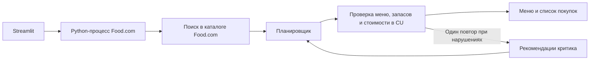
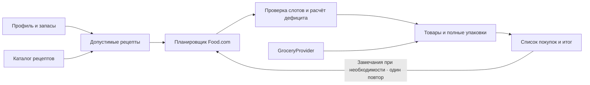

# Интеграция трёхдневного спринта

Сквозной прототип принимает профиль, запасы, каталог и поставщика товаров.
В тестовом сценарии он формирует 10 блюд и 5 строк покупок на 1 710 ₽ при
бюджете 5 000 ₽.

## Текущая архитектура MVP



## Интеграционное демо спринта



| Где смотреть | Что используется |
|---|---|
| [Основной MVP](ARCHITECTURE.md) | `workflow/foodcom.py` управляет поиском, планировщиком и проверкой меню. |
| [Схемы Food.com](../src/smart_grocery/schemas/foodcom.py) | Активные `Request`, `Recipe`, `Ingredient`, `Meal`, `Plan` и `Price` вынесены из `budget_v2.py`. Старые импорты работают. |
| [Ранние схемы](../src/smart_grocery/schemas/models.py) | `PlanningRequest` и `Recipe(id, name, ...)` используются в раннем `workflow/runner.py` и проверках совместимости. |
| [Интеграция спринта](../src/smart_grocery/workflow/integration.py) | Общий поиск по диете и времени, планировщик и расчёт количеств переиспользуются. В оценке используются товарные упаковки и рублёвый бюджет. |
| [Интерфейс](../app.py) | Переключатель «Интеграционное демо» открывает редактируемый профиль и результаты Golden Test Case. |

Переходы реализованы обычными Python-функциями. Общий цикл Food.com выполняет до двух попыток. В интеграционном режиме повтор получает сообщения проверки стоимости и состава корзины. Mock-планировщик воспроизводит порядок кандидатов, поэтому при снижении бюджета проверка показывает превышение. Потребность в дополнительных ветвлениях, передаче управления и сохранении состояния графа стоит оценить при подключении реальных адаптеров.

## Контракты для согласования

| Владелец | Сущность | Поля на стыке |
|---|---|---|
| Роль 1 | `Recipe` | `recipe_id`, `title`, `servings`, `cook_minutes`, `tags`, `ingredients`. Дополнительные поля: `instructions`, `cuisine`, `meal_type`, `nutrition`, `source`, `allergens_status`, `allergens`. |
| Роль 2 | `UserProfile` | `user_id`, `household_size`, `allergies`, `dietary_pattern`, `disliked_ingredients`, `preferred_cuisines`, `goals`, `budget`, `currency`, `max_cooking_time`. |
| Роль 2 | `InventoryItem` | `ingredient_id`, `display_name`, `quantity`, `unit`, `expiry_date`, `source`, `confidence`. |
| Роли 2 и 4 | `MealPlan` | `days`, `meals[{day, slot, recipe_id, servings}]`, `planned_ingredients`, `reasoning_summary`. |
| Роль 3 | `ProductOffer` | `ingredient_id`, `retailer`, `product_id`, `title`, `package_quantity`, `package_unit`, `price`, `currency`, `availability`, `url`, `retrieved_at`. Опционально состав, аллергены, бренд и пищевая ценность. |
| Роли 3 и 4 | `ShoppingList` | `currency`, `lines`, `priced_subtotal`, `estimated_total`. Строка содержит `ingredient_id`, `unit`, `required_quantity`, `inventory_quantity`, `missing_quantity`, `matched_offers`, `selected_offer`, `package_count`, `estimated_total`. |

- Идентификаторы ингредиентов и аллергенов передаются в `snake_case`. Источники нормализуют синонимы до расчёта. Единицы — `g`, `ml`, `pcs`. Десятичные значения сериализуются в JSON строками.
- `allergens_status="confirmed"` требует явный список, включая `[]`. Для неполных данных используется `"unknown"` и `allergens=null`. При активной аллергии рецепт или товар с неизвестным статусом исключается из выбора. Пользовательские исключения проверяются по идентификаторам ингредиентов рецепта до вызова планировщика.
- `dietary_pattern` содержит обязательные теги каталога. `preferred_cuisines` и `goals` влияют на порядок кандидатов. Значения `goals` сопоставляются с тегами рецепта, например `high_protein`.
- В расчёте учитываются позиции с `confidence=1` без истекшего срока годности. Планирование рассчитывает дефицит и оставляет исходные запасы в прежнем виде.
- Цена предложения указана за полную упаковку в `currency`. `retrieved_at` содержит часовой пояс. При совпадении ингредиента, единицы и валюты выбирается доступное предложение с наименьшей стоимостью покупки целых упаковок. При равной цене учитывается излишек. Полный итог равен `null`, если остаются неоценённые строки. `priced_subtotal` показывает сумму известных строк.

### GroceryProvider

[Интерфейс и mock](../src/smart_grocery/tools/grocery_provider.py) принимают канонический идентификатор для `search_products(ingredient_id)` и ID товара для `get_product_details(product_id)` и `check_availability(product_id)`. Методы поиска возвращают нормализованные совпадения, а расчёт использует наличие из снимка предложения. Для сбоя поиска адаптер поднимает `ProviderUnavailable`: меню и остальные цены остаются доступны. `create_cart(items)` и `cart_link(items)` возвращают объект `NotSupported`, если поставщик не поддерживает операцию.

## Воспроизведение

Из корня рабочей копии с установленными зависимостями:

```powershell
python -m pip install -r requirements.txt
python scripts/run_integration.py
python -m pytest -q
python scripts/check_data.py
python -m streamlit run app.py
```

В Streamlit включите **Интеграционное демо** и нажмите **Рассчитать меню и покупки**. CLI печатает полный JSON результата и завершает работу с кодом 0 при успешной проверке. Демо в CLI и Streamlit работает автономно даже при включённом live-режиме приложения.

[Скриншот результата в Streamlit](assets/sprint-integration-demo.jpg)

Входные данные — [профиль, запасы и рецепты](../fixtures/integration/golden_case.json) и [предложения магазина](../fixtures/integration/mock_offers.json). Два из пяти рецептов подходят под профиль. Рецепты с арахисом, кинзой и неизвестным составом отсеиваются до планирования.

| Ингредиент | Нужно | Дома | Докупить | Упаковки | Итог |
|---|---:|---:|---:|---:|---:|
| Куриная грудка | 1 300 г | 400 г | 900 г | 3 × 400 г | 930 ₽ |
| Яйца | 10 шт. | 6 шт. | 4 шт. | 1 × 6 шт. | 110 ₽ |
| Оливковое масло | 100 мл | 0 мл | 100 мл | 1 × 250 мл | 240 ₽ |
| Рис | 1 100 г | 500 г | 600 г | 2 × 400 г | 240 ₽ |
| Помидоры | 625 г | 300 г | 325 г | 2 × 250 г | 190 ₽ |

Молока требуется 600 мл, дома 1 000 мл. Общая сумма 1 710 ₽, остаток бюджета 3 290 ₽. При бюджете 100 ₽ в демо появится предупреждение о превышении. В [интеграционных тестах](../tests/test_sprint_integration.py) также проверяются пропуск цены в нужной валюте, неизвестный состав, ошибка магазина, неподдерживаемая корзина, истекшие запасы и несовместимые единицы.

## Сценарий технической демонстрации

1. Открыть схему модулей и показать границы ответственности.
2. Запустить в Streamlit тестовый профиль на пять дней для двоих и проверить 10 блюд, ограничения профиля и пять строк покупок.
3. Показать расчёт: из 1 100 г риса 500 г покрываются домашним остатком, а недостающие 600 г закупаются двумя упаковками по 400 г за 240 ₽.
4. Снизить бюджет до 100 ₽ и проверить предупреждение о превышении без потери рассчитанного списка.
5. Показать проверки состава, единиц, подтверждённых запасов и нормализованных предложений магазина.

## Технические блокеры и точки расширения

| Где расширять | Что блокирует командную сборку | Что должно быть на входе |
|---|---|---|
| Каталог и поиск (`data/`, `tools/recipes.py`) | В Food.com рис, молоко и помидоры заданы в `pcs`. Подтверждённой аллергенной разметки пока нет. | Роль 1 формирует проверенную выборку с каноническими ID, сопоставимыми единицами и явным статусом аллергенов. |
| Профиль и запасы (`schemas/integration.py`, `app.py`) | Демо получает запасы из тестового набора. Нужно согласовать подтверждение запасов, срок годности и нормализацию ID. | Роль 2 формирует пример профиля и запасов в общих форматах. |
| Предложения магазина (`tools/grocery_provider.py`) | Для живых цен, наличия и состава нужен проверенный адаптер. Возможность создать корзину зависит от поставщика. | Роль 3 предоставляет адаптер и пример предложения с ценой за упаковку, валютой, наличием, статусом состава и временем получения. |
| Сквозной процесс (`workflow/integration.py`) | Golden Test Case проверен на тестовых данных. Совместимость выходов трёх модулей ещё предстоит проверить. | Роль 4 подключает данные модулей, проверяет расхождения и фиксирует результаты прогона. |

## План следующего этапа

1. Согласовать контракты. Для ролей 1–3 приложить по одному примеру выхода соответствующего модуля.
2. Подключить проверенные рецепты и запасы, затем заменить mock на адаптер магазина. Прогнать Golden Test Case после каждого подключения.
3. Принять интеграцию, когда меню соблюдает ограничения, запасы вычитаются в сопоставимых единицах, а рублёвый итог учитывает полные упаковки. Если цена части товаров неизвестна, список сохраняется и показывает частичный итог.
4. Вернуться к выбору LangGraph, когда появится сценарий с несколькими путями или паузой на подтверждение пользователя.

