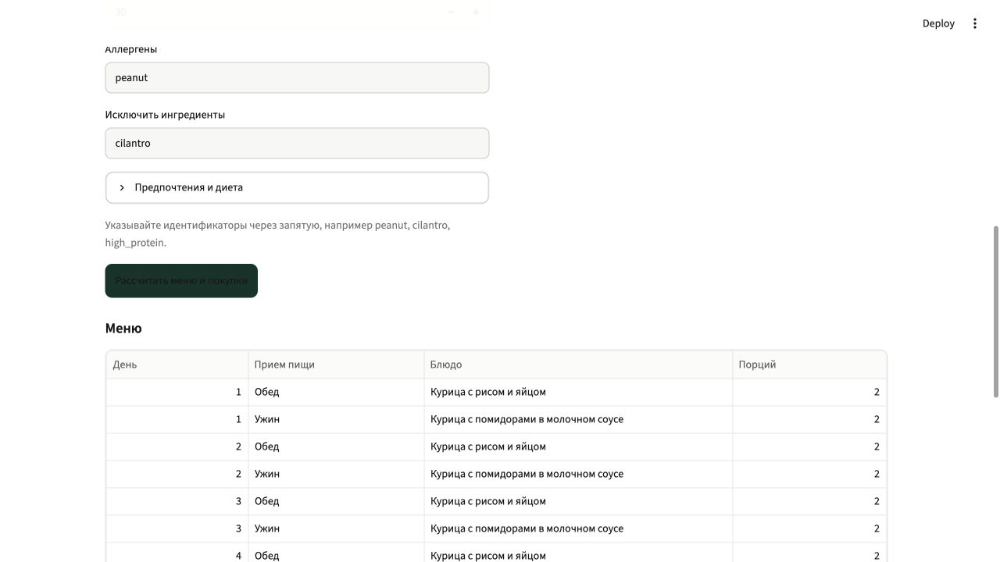

# Единая версия Smart Grocery Agents

Проверка: 28.11.2026. Объединены изменения PR #6, #7, #8 и #9 с сохранением истории авторов.

## Что объединено

- Общие Pydantic-контракты профиля, запасов, рецептов, меню, предложений и покупок.
- Каталог Food.com и Wikibooks: инструкции, ссылки на источники, постраничный SQLite FTS5-поиск и отчет качества.
- Персонализация: обязательные ограничения по составу, диете, исключениям и времени; ранжирование по кухне, целям и домашним запасам.
- Запасы: подтвержденность, срок годности, открытая упаковка, FEFO и отдельное подтверждение списания. Само планирование ничего не списывает.
- Планировщик Gemini, отдельный критик и одна повторная попытка. Критик дополняет рекомендации; расчеты и нарушения остаются результатом Python.
- Магазины: тестовый провайдер, сохраненные реальные ответы и публичный MCP ВкусВилла. Расчет целыми упаковками; неизвестные цена, наличие, состав и устаревшие предложения препятствуют окончательному расчету.
- Единая навигация Streamlit: исходное меню, профиль и запасы, каталог, товары магазинов.

В разделе «Профиль и запасы» источники рецептов и цен выбираются независимо. Модель включается отдельно при наличии локальной конфигурации; по умолчанию этот раздел автономный. При смене источника предыдущий результат очищается. Инструкции выбранных блюд отображаются, если они есть в источнике.



## Запуск

```bash
git clone https://github.com/asastyy/smart-grocery-agents.git
cd smart-grocery-agents
docker compose up --build
```

По умолчанию: http://localhost:8501. `.env` необязателен для автономной работы. Для Gemini скопируйте `.env.example` в `.env`, заполните ключ и модель, установите `MOCK_LLM=false`, затем пересоздайте контейнер. Ключи в Git не добавляются.

Если порт занят: `APP_PORT=8505 docker compose up --build`. На Windows PowerShell: `$env:APP_PORT=8505`, затем обычная команда запуска.

Контейнер работает непривилегированным пользователем; поисковая база создается в доступном для записи каталоге. Docker Compose сохраняет ее в томе `catalog-cache`. Исходные многогигабайтные выгрузки исключены из контекста сборки.

В репозитории автономная выборка **8681 рецепт**. Полный импорт **522 798 рецептов** выполняется отдельно:

```bash
docker compose exec app python scripts/build_catalog_db.py --download
```

Нужны сеть, время и несколько гигабайт свободного места. Полная база на компьютере разработчика не переносится автоматически в контейнер. Каталог не скачивается при обычном запуске.

## Проверки

- 240 тестов проходят локально и внутри свежего контейнера Python 3.11 без сети и ключей.
- Контроль исходных данных: 150 рецептов, 503 ингредиента, 503 демонстрационные цены.
- Воспроизводимый сценарий: 2 человека, 5 дней, 10 приемов пищи, 5 строк покупок, 1710 RUB по тестовым ценам.
- Проверены переход от каталога к персонализации и остановка до вызова LLM при неизвестном аллергенном составе.
- Проверены расчет упаковок, сохранение частичного итога и очистка старых тестовых цен при переключении источника.
- Реальный запрос Gemini: меню из разрешенных ID, результат подтвержден расчетом Python.
- При нулевом бюджете на один день: отдельный критик и повторное планирование; исправленное меню полностью покрыто запасами, Python подтвердил итог 0 RUB. Неразрешимый бюджет проверен отдельными тестами.
- Docker: сборка с установкой зависимостей, запуск без `.env`, создание SQLite непривилегированным пользователем, проверка всех разделов приложения.

GitHub Actions автоматически не включен: ранее учетным данным не хватало права `workflow`. Шаблон остается в `docs/github-tests.yml`; локальные и контейнерные проверки выполнены независимо от него.

## Границы и блокеры

1. **Большой каталог — источник для поиска и подготовки данных.** Только 4 записи проходят текущие структурные требования адаптера; это не ручное подтверждение качества. Аллергены импортированных рецептов неизвестны. При заданной аллергии такие записи не допускаются в планирование.
2. **Готовый сквозной сценарий пока использует тестовые рецепты и цены.** Он проверяет стыки модулей, а не доказывает бытовую пригодность всего каталога.
3. **ВкусВилл:** ранее сохраненные реальные ответы доступны. Повторный публичный запрос 28.11.2026 завершился `mcp_transport_error`. Это ошибка сетевого обращения, а не доказательство изменения API или необходимости авторизации. Автоматического подтверждения наличия по адресу и аллергенов нет.
4. **Лавка:** неофициальный MCP отвечает, но поиск требует пользовательской сессии и адреса. Подготовлен изолированный сценарий настройки; сессия не предоставлена. В общую сборку он не включен как рабочий источник цен.
5. **Купер:** нужен доступ к партнерскому API. Автоматических заказов и оплаты нет.
6. **Запасы:** правила обновления и события реализованы на уровне Python. Постоянная база профилей, идемпотентное списание между сеансами и полноценный редактор запасов в интерфейсе остаются следующим этапом. Распознавание продуктов по фото не реализовано.
7. **LLM:** максимум две попытки составления меню; в каждой возможны два ответа при исправлении формата. Критик вызывается только перед повторным планированием и также может исправить формат один раз. Поэтому верхняя граница — 6 сетевых запросов, обычный успешный путь — 1. Сетевые ошибки планировщика показываются пользователю; подмена такого сбоя успешным ответом модели не выполняется.

## Следующая работа

Сначала подготовить небольшой проверенный набор полноценных блюд: количества, единицы, порции, общее время и инструкции. Затем подключить постоянное хранение профиля/запасов и подтвержденный контекст магазина. После этого сравнить качество меню Gemini с простым алгоритмом на одинаковых сценариях. Расширение каталога само по себе не решает эти ограничения.
